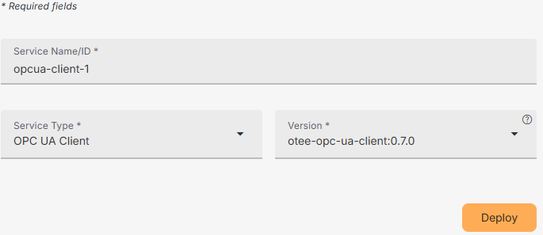
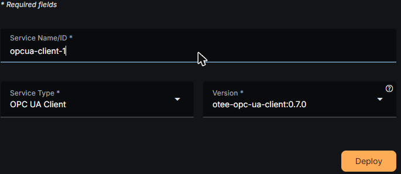
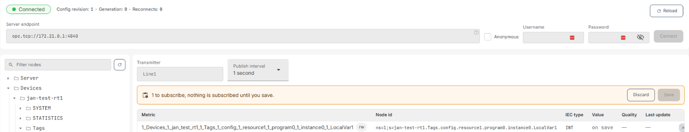
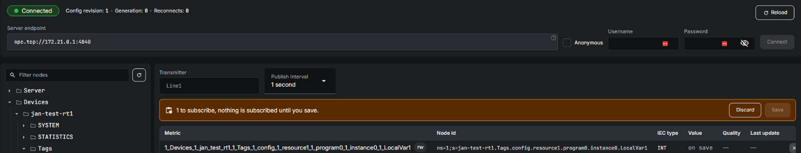

The OPC UA Client lets your vPLC consume data from an OPC UA server on your network — for example a PLC, historian, or other industrial system that exposes its data over OPC UA — and make that data usable in OTee, both for monitoring and to drive control logic.

<Note>
OPC UA Client support may require you to upgrade your plan.
</Note>

## Deploying the service

The OPC UA Client runs as its own service on a device, alongside your Agent, NATS, and Runtime services.

On your device's page, press "Deploy a service", choose **OPC UA Client** from the Service Type drop-down, give the service a name, and confirm the version. Press "Deploy" to install it.

Once deployed, the service shows up alongside your device's other services. Press "Configure" on it to open the OPC UA client page. All configuration — the server connection, mapped variables, and subtree watches — is done live from that page, not at deploy time; the deploy form only installs the service itself.

<Tip>
Redeploying or upgrading the service later doesn't erase configuration you've already saved from this page. Your server connection and mapped variables persist across service updates.
</Tip>

## Connecting to an OPC UA server

At the top of the OPC UA client page, enter the **server endpoint** of the OPC UA server you want to connect to (for example `opc.tcp://<host>:4840`). If the server doesn't require authentication, check **Anonymous**; otherwise provide a username and password. Press "Connect".

<Warning>
Pressing "Connect" — even to re-apply the same endpoint — drops the client's current session: it reconnects, live values pause, and the browse cache is discarded. Avoid re-connecting unnecessarily while things are working.
</Warning>

The status indicator at the top left shows whether the client is currently connected, along with the config revision, generation, and reconnect count for the session. If the client goes quiet, a "Last seen" timestamp appears. Use the "Reload" button to make the client re-read its last saved configuration — it's a safe way to retry if a change doesn't seem to have taken effect, since it just re-applies what's already persisted.

## Discovering and mapping data

Once connected, use the node tree on the left to browse the server's address space. Expanding a folder sends a live browse request to the server, so the tree always reflects what the server currently exposes — use the refresh icon above the tree to re-browse if the server's structure has changed. Use the filter box to search the tree by name. The server answers one browse request at a time, so expanding many folders in a large tree can take a moment to catch up.

Each variable shows its IEC 61131-3 data type next to it. Variables with a type OTee doesn't support are labeled "no IEC type" and can't be selected.

Check the box next to any variable you want to bring into OTee. Checked variables are staged on the right, under the **transmitter** name and **publish interval** you've configured — nothing is actually subscribed until you press "Save". Give the transmitter a descriptive name; this is the name your data will be grouped under once it's published. You can hand-pick variables into one transmitter at a time this way; for whole subtrees, see below.

The staged table shows, for each variable, its OPC UA node ID and IEC 61131-3 data type, plus live value, quality, and last-update columns once it's actually publishing. A variable the server reports as writable is marked with an "rw" badge — this is detected automatically from the server, not something you set. Use "Discard" to clear your staged picks without saving, or "Save" to apply them — this bumps the config revision and (re)subscribes to the selected variables. Saving also applies any subtree watches you've staged (see below).

## Watching a whole subtree

Instead of picking variables one at a time, you can watch an entire branch of the server's address space at once. Next to any expandable node in the tree, press the subtree icon to stage a watch on it and give it a transmitter name.

A subtree watch automatically finds every usable variable up to 5 levels beneath the node, publishes their values every second, and re-browses the subtree every 10 minutes to pick up anything the server adds or removes — so it stays in sync without you having to revisit the tree. A client can have up to 20 subtree watches at a time. Because a watch owns its transmitter, its metrics can't be hand-edited individually while the watch is active — remove the watch first if you need to.

Staged and saved watches appear in their own panel above the transmitter table; expand one to see its current metrics. Like individually-picked variables, a watch isn't actually active until you press "Save", and nodes already covered by a watch are marked "watched" in the tree so you don't stage them again by hand.

## Using the data in your project

Data published by the OPC UA Client becomes available in your projects the same way as any other namespace data: via the [Namespace driver](/io-cfg/namespace). Add a Namespace driver configuration to your project and select the transmitter you configured here to bring its variables in as tags you can use in your control logic.
